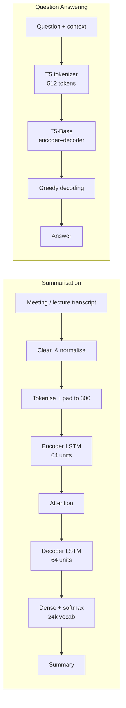

# Meeting & Lecture Summarisation + Question Answering

Two end-to-end NLP systems in one repository: a **Seq2Seq LSTM with attention** that turns long conversations into short summaries, and a **fine-tuned T5-Base transformer** that answers questions from a supplied passage.


> **Status:** research/academic prototype. The repository contains the training and inference notebooks. A graphical interface is designed but not yet implemented.

---

## Overview

| | Project 1 | Project 2 |
|---|---|---|
| **Task** | Abstractive dialogue summarisation | Context-grounded question answering |
| **Input** | Multi-turn meeting/chat transcript | Question + supporting passage |
| **Output** | Short generated summary | Short generated answer |
| **Model** | Encoder–decoder LSTM + attention | T5-Base (`t5-base`) |
| **Framework** | TensorFlow / Keras | PyTorch + PyTorch Lightning |
| **Dataset** | Dialogue–summary corpus (SAMSum-style, 16,368 pairs) | SQuAD, 5,000 training records |
| **Evaluation** | BLEU, ROUGE-1/2/L | Test loss |

The two projects share a common idea: **condense or interrogate long text without relying on general world knowledge**. The summariser compresses a whole conversation; the QA system answers strictly from the context it is given.

### Contents

- [Results at a Glance](#results-at-a-glance)
- [Architecture](#architecture)
- [Project 1: Meeting and Lecture Summarisation](#project-1-meeting-and-lecture-summarisation)
- [Project 2: Question Answering with T5-Base](#project-2-question-answering-with-t5-base)
- [Tech Stack](#tech-stack)
- [Repository Structure](#repository-structure)
- [Getting Started](#getting-started)
- [Usage](#usage)
- [Evaluation Notes & Caveats](#evaluation-notes--caveats)
- [Limitations](#limitations)
- [Roadmap](#roadmap)
- [Credits](#credits)
- [License](#license)

### Why these two together?

- **Same preprocessing mindset** — normalise noisy conversational/paragraph text before modelling.
- **Two generations of NLP** — a from-scratch recurrent encoder–decoder and a pretrained transformer, side by side.
- **Complementary use cases** — summarise a lecture, then ask questions about the details that were compressed away.

---

## Results at a Glance

### Summarisation

| Metric | Score |
|---|---:|
| BLEU | **0.9299** |
| ROUGE-1 | **0.9689** |
| ROUGE-2 | **0.9430** |
| ROUGE-L | **0.9689** |
| Best validation loss | **0.1770** (epoch 23) |
| Best validation accuracy | **98.75%** (token-level) |
| Trainable parameters | **17,683,136** (67.46 MB) |

### Question answering

| Metric | Score |
|---|---:|
| Test loss | **1.3955** |
| Training epochs | 5 |
| Showcased predictions correct | 2 of 3 |

> ⚠️ **Read the caveats before quoting these numbers.** The summarisation scores were computed with **teacher forcing** (the reference summary was fed to the decoder), and the test split doubled as the validation split. They are preliminary and optimistic, not a measure of free-running generation quality. QA is reported by loss only; Exact Match and F1 are not implemented. See [Evaluation Notes & Caveats](#evaluation-notes--caveats).

---

## Architecture



**Summarisation flow:** `dialogue → preprocessing → Keras tokenizer → padded sequences → embedding → encoder LSTM → attention over encoder states → decoder LSTM → softmax → detokenised summary`

**QA flow:** `question + context → cleaning → T5 sentencepiece tokenizer → T5 encoder → T5 decoder → generated token ids → decoded answer`

---

## Project 1: Meeting and Lecture Summarisation

Notebook: [`Meeting or Lecture Summarisation.ipynb`](Meeting%20or%20Lecture%20Summarisation.ipynb)

### Dataset

A dialogue–summary corpus in SAMSum format.

| Property | Value |
|---|---|
| Records | 16,368 dialogue–summary pairs |
| Columns | `id`, `dialogue`, `summary` |
| Mean dialogue length | 511 characters (median 400) |
| Mean summary length | 110 characters (median 96) |
| Longest dialogue | 5,492 characters |
| Longest summary | 300 characters |
| Combined vocabulary | 35,134 unique tokens (capped at 24,000) |
| Train / test split | 11,457 / 4,911 (70/30) |

Example record:

```text
Dialogue : Amanda: I baked cookies. Do you want some? ...
Summary  : Amanda baked cookies and will bring Jerry some ...
```

> **Data loading note:** the notebook's three `pd.read_csv(...)` calls currently point at a local placeholder path (`glove.6B.100d.txt`). Replace them with the actual dialogue–summary CSV before rerunning. The committed outputs were produced from the 16,368-row SAMSum-style corpus above.

### Exploratory Data Analysis

The notebook profiles the corpus before modelling:

- Dialogue and summary length distributions
- Word clouds for dialogues and summaries
- **Flesch Reading Ease** comparison (dialogue vs summary)
- **Compression ratio** (`dialogue_len / summary_len`)
- **Jaccard similarity** between dialogue and summary tokens
- **TF-IDF keyword overlap** (1,000 features)
- **Novelty ratio** — share of summary words absent from the dialogue, used as a proxy for abstraction

These features motivate the modelling choices: conversations are long and noisy, while reference summaries are short, readable and only partially extractive.

### Preprocessing

Applied identically to dialogues and summaries:

1. Expand chat abbreviations (`lol`, `brb`, `asap`, …) using a custom dictionary
2. Lowercase
3. Remove URLs
4. Strip non-alphanumeric characters (HTML/emoji/special symbols)
5. Remove emoji ranges explicitly
6. Expand contractions (`don't` → `do not`)
7. Wrap summaries with `<sos>` … `<eos>` markers
8. Fit a Keras `Tokenizer` (`num_words=24,000`)
9. Pad/truncate to **300 dialogue tokens** and **50 summary tokens** (post-padding)

```python
MAX_VOCAB_SIZE = 24_000
max_dialogue_len = 300
max_summary_len  = 50

X = pad_sequences(df["dialogue"], max_dialogue_len, padding="post", truncating="post")
y = pad_sequences(df["summary"],  max_summary_len,  padding="post", truncating="post")
```

### Model

A sequence-to-sequence LSTM with additive attention:

| Component | Configuration |
|---|---|
| Embedding (encoder & decoder) | 300-dim, 24,000 vocab |
| Encoder LSTM | 64 units, `return_sequences=True`, dropout 0.2, recurrent dropout 0.1 |
| Decoder LSTM | 64 units, initial state = encoder states, dropout 0.3, recurrent dropout 0.2 |
| Attention | Keras `Attention` over decoder outputs and encoder outputs |
| Fusion | Concatenate decoder output + context vector, then LayerNorm |
| Output | Dense 24,000 + softmax |
| Total parameters | 17,683,136 (67.46 MB) |

> The embedding layers are trained from scratch. A GloVe file is present in the workspace, but GloVe initialisation is not wired into the current notebook.

### Training

| Setting | Value |
|---|---|
| Loss | Sparse categorical cross-entropy |
| Optimizer | Adam, learning rate `1e-3` |
| Batch size | 64 |
| Max epochs | 50 |
| Early stopping | `val_loss`, patience 20, restore best weights, start at epoch 3 |
| LR schedule | `ReduceLROnPlateau`, factor 0.1, patience 10, min LR `1e-6` |
| Checkpoint | `samsum_dialogues_text_summarizer.keras` (best `val_loss`) |
| Mixed precision | `mixed_float16` |
| Logging | TensorBoard |

Training stopped early at epoch 43 and restored the epoch-23 weights:

```text
Epoch 23: val_accuracy: 0.9875 - val_loss: 0.1770
...
Epoch 43: early stopping
Restoring model weights from the end of the best epoch: 23.
```

Training accuracy reached `1.0000` while validation loss plateaued around `0.177` — a clear overfitting signal.

### Inference

```python
summarize_model_predictions(model, tokenizer, X_test, y_test, num_samples=10)
```

The helper decodes predicted token IDs back to words, filters padding/`<sos>`/`<eos>`, and prints dialogue → reference → prediction.

Example output:

```text
Dialogue:
bob hey pick up your phone sam cannot i am on a date in a theater ...

Actual Summary:
sam is in a theater on a date he will call bob later

Predicted Summary:
sam is in a theater on a date he will call bob later
```

> Inference currently passes `y_test` as the decoder input, i.e. **teacher forcing**. A true demo should decode autoregressively, one token at a time, starting from `<sos>`.

### Evaluation

- **BLEU** via `nltk.translate.bleu_score.corpus_bleu`
- **ROUGE-1/2/L F-measure** via `rouge_score.RougeScorer(..., use_stemmer=True)`

Scores are averaged over the full 4,911-sample test split: BLEU `0.9299`, ROUGE-1 `0.9689`, ROUGE-2 `0.9430`, ROUGE-L `0.9689`.

---

## Project 2: Question Answering with T5-Base

Notebook: [`Question Answering System.ipynb`](Question%20Answering%20System.ipynb)

### Dataset

**SQuAD** loaded through Hugging Face Datasets:

```python
from datasets import load_dataset
data = load_dataset("squad", split="train[:5000]")
```

| Property | Value |
|---|---|
| Records | 5,000 |
| Features | `id`, `title`, `context`, `question`, `answers` |
| Train / validation / test | 3,800 / 200 / 1,000 |
| Shuffle seed | 32 |

### Preprocessing

```python
def cleaning(text, punct):
    cleaned_text = clean(
        text, lower=True, no_punct=punct, lang="en", ...
    )
    tokens = word_tokenize(cleaned_text)
    return " ".join(w for w in tokens if w not in stopwords.words("english"))
```

1. `cleantext.clean` with lowercasing and optional punctuation removal
2. NLTK `word_tokenize`
3. English stopword removal
4. Assemble a `question / context / answers` DataFrame

> Because stopwords and punctuation are removed, the model sees input like `place game take nintendos official list 100 greatest nintendo games time`. This keeps sequences short but strips grammatical cues and can hurt answer fidelity. Removing this step is a recommended improvement.

### Tokenisation

| Setting | Value |
|---|---|
| Tokenizer | `T5Tokenizer` from `t5-base` |
| Source max length | 512 |
| Target max length | 64 |
| Padding | `max_length` |
| Truncation | Enabled |
| Labels | Padding IDs set to `-100` (ignored by the loss) |

Input format pairs the question with the context; the target is the answer string.

### Model

```python
config = T5Config.from_pretrained(
    "t5-base",
    dropout_rate=0.3,
    feed_forward_proj="relu",
    layer_norm_epsilon=1e-6,
)
model = T5ForConditionalGeneration.from_pretrained("t5-base", config=config)
```

Wrapped in a PyTorch Lightning module with `training_step`, `validation_step`, `test_step` and `configure_optimizers`. Loss is T5's built-in cross-entropy over shifted labels.

### Training

| Setting | Value |
|---|---|
| Optimizer | `AdamW`, learning rate `3e-4` |
| Batch size | 2 |
| Epochs | 5 |
| Hardware | Configured for 1× GPU (`accelerator="gpu"`) |
| Checkpoint | `checkpoints/best-checkpoint.ckpt` (best `val_loss`) |

> On a CPU-only machine, change `accelerator="gpu"` to `accelerator="auto"` (or `"cpu"`).

### Inference

```python
def generate_answer(question):
    source_encoding = tokenizer(
        question["question"], question["context"],
        max_length=512, padding="max_length", truncation=True,
        return_attention_mask=True, add_special_tokens=True, return_tensors="pt",
    )

    generated_ids = trained_model.model.generate(
        input_ids=source_encoding["input_ids"],
        attention_mask=source_encoding["attention_mask"],
        num_beams=1,               # greedy search
        max_length=80,
        repetition_penalty=2.5,
        early_stopping=True,
        use_cache=True,
    )

    return "".join(
        tokenizer.decode(g, skip_special_tokens=True, clean_up_tokenization_spaces=True)
        for g in generated_ids
    )
```

Example predictions from the validation set:

| Question (after cleaning) | Expected | Predicted | Match |
|---|---|---|---|
| `place game take nintendos official list 100 greatest nintendo games time` | `16th` | `4th` | ❌ |
| `beyonce said embodies definition inspiration strong woman` | `oprah winfrey` | `oprah winfrey` | ✅ |
| `besides sprectrum activity chemical structure antibacterial antibiotics classified` | `mechanism action` | `mechanism action` | ✅ |

### Evaluation

- **Test loss:** `1.3955`
- **Exact Match / F1:** not implemented

---

## Tech Stack

| Layer | Tools |
|---|---|
| Language | Python 3.10+ |
| Notebooks | Jupyter, Kaggle kernels |
| Summarisation | TensorFlow 2.x, Keras, NumPy, pandas, scikit-learn |
| QA | PyTorch, PyTorch Lightning, Hugging Face Transformers, Datasets |
| NLP utilities | NLTK, CleanText, `contractions`, `sentencepiece`, `tokenizers` |
| Visualisation | Matplotlib, Seaborn, WordCloud |
| Metrics | `rouge-score`, NLTK BLEU, `textstat` |
| Experiment tracking | TensorBoard, Lightning `ModelCheckpoint` |

---

## Repository Structure

```text
NLP Projects/
├── Meeting or Lecture Summarisation.ipynb   # Project 1: EDA, training, evaluation
├── Question Answering System.ipynb          # Project 2: T5 fine-tuning and inference
├── README.md
├── glove.6B.100d.txt/
│   └── glove.6B.100d.txt                    # GloVe vectors (not yet wired into the model)
├── screenshots/                             # Notebook/presentation figures
├── gui/                                     # Placeholder for the planned interface (empty)
├── NLP Capstone project.docx                # Original project brief
└── Combined Summarisation and QA Professional.pptx

# Generated at runtime (not committed):
#   samsum_dialogues_text_summarizer.keras
#   checkpoints/best-checkpoint.ckpt
#   model.png
```

---

## Getting Started

### Prerequisites

- Python 3.10+
- Jupyter Notebook / JupyterLab
- GPU recommended for training (the notebooks were run on a Kaggle P100); CPU works for inference, but training the LSTM on the full corpus is slow

### Installation

```bash
git clone https://github.com/<your-username>/meeting-summarizer-qa.git
cd meeting-summarizer-qa

python -m venv .venv
# Windows
.venv\Scripts\activate
# macOS / Linux
source .venv/bin/activate
```

Install the dependencies for the project you want to run:

```bash
# Summarisation
pip install tensorflow pandas numpy scikit-learn matplotlib seaborn \
            nltk rouge-score textstat contractions wordcloud tqdm

# Question answering
pip install torch pytorch-lightning transformers datasets clean-text \
            sentencepiece tokenizers pandas nltk
```

> The QA notebook pins `transformers==4.25.0`. That release is old and may not install cleanly on newer Python versions; prefer a current `transformers` release unless you specifically need to reproduce the original environment.

Download the NLTK resources once:

```python
import nltk
for resource in ("punkt", "punkt_tab", "stopwords", "omw-1.4"):
    nltk.download(resource)
```

### Data

| Project | How to get it |
|---|---|
| Summarisation | Download [SAMSum](https://huggingface.co/datasets/samsum) (or any CSV with `id`, `dialogue`, `summary`) and update the three `pd.read_csv(...)` paths in the notebook |
| QA | Downloaded automatically by `load_dataset("squad", ...)` on first run |

### Run the notebooks

```bash
jupyter lab
```

Open either notebook and run all cells. The summarisation notebook writes `samsum_dialogues_text_summarizer.keras`; the QA notebook writes `checkpoints/best-checkpoint.ckpt`.

---

## Usage

### Summarise a transcript

```python
import tensorflow as tf
from tensorflow.keras.preprocessing.sequence import pad_sequences

model = tf.keras.models.load_model("samsum_dialogues_text_summarizer.keras")

# Apply the notebook's cleaning pipeline first (chat-word expansion, lowercase,
# URL / emoji / special-character removal, contraction expansion), then:
sequence = tokenizer.texts_to_sequences([cleaned_text])
padded = pad_sequences(sequence, max_dialogue_len, padding="post", truncating="post")

# The notebook's `summarize_model_predictions` helper feeds the reference
# summary as the decoder input (teacher forcing). For free-running generation,
# start from <sos> and feed each predicted token back into the decoder.
```

### Answer a question

```python
trained_model = SquadQAModel.load_from_checkpoint("checkpoints/best-checkpoint.ckpt")
trained_model.freeze()

row = {
    "question": "who wrote the declaration of independence",
    "context": "the declaration of independence was written by thomas jefferson ...",
}
print(generate_answer(row))
```

### Interactive demo (planned)

The intended GUI flow — designed but not implemented:

```text
Open the app
  → paste a transcript, or enter a question + context
  → click "Summarise" / "Get Answer"
  → backend preprocesses the text
  → trained model runs
  → summary or answer is displayed
```

Planned controls: transcript upload / paste box, question box, context box, **Generate Summary** / **Get Answer** buttons, and an output panel.

---

## Evaluation Notes & Caveats

1. **Teacher forcing in the summariser.** Both the sample predictions and BLEU/ROUGE are computed by passing the reference summary as the decoder input. This makes the task much easier than real generation. The high scores therefore do **not** mean the model can write summaries from scratch at that quality.
2. **Test split = validation split.** The summariser trains on 70% and evaluates on the same 30% used for early stopping and checkpoint selection.
3. **Token accuracy is not summary quality.** `accuracy: 1.0000` reflects next-token prediction on padded sequences, dominated by common tokens and padding.
4. **Overfitting.** Training loss fell to `0.0025` while validation loss rose after epoch 23.
5. **QA metrics are incomplete.** Only test loss (`1.3955`) is reported; Exact Match and F1 — the standard SQuAD metrics — are not implemented.
6. **QA preprocessing is aggressive.** Stopword and punctuation removal makes inputs ungrammatical and can remove answer-relevant tokens.
7. **Context truncation.** SQuAD passages are cut to 512 tokens; for long contexts the gold answer may fall outside the window.
8. **Two showcased examples are not a benchmark.** The 2-of-3 correct examples are illustrative only.

---

## Limitations

- The summariser is trained from scratch on a relatively small corpus; it copies reference phrasing heavily under teacher forcing.
- The model is trained for English chat-style dialogue and has not been validated on formal lectures, meeting transcripts, or long documents.
- Summaries are capped at 50 tokens, so longer references can be truncated mid-sentence.
- No speaker-aware encoding: speaker turns are flattened into plain text.
- The QA model is extractive-in-spirit but generative in implementation — it can hallucinate answers not present in the context.
- No confidence score is returned by either model.
- **No GUI is implemented**; `gui/` is an empty placeholder.
- Notebook paths are absolute/local and must be updated before rerunning.
- No unit tests, packaging, or CI.

---

## Roadmap

**Evaluation (highest priority)**

- [ ] Re-evaluate the summariser with autoregressive decoding and an independent held-out test set
- [ ] Add Exact Match and F1 for QA; report on the SQuAD dev split
- [ ] Add ROUGE-Lsum and BERTScore for summarisation

**Model quality**

- [ ] Initialise embeddings from GloVe, or replace the LSTM with a pretrained BART/T5 summariser
- [ ] Add beam search and length-normalised decoding
- [ ] Experiment with T5-Large / instruction-tuned models for QA
- [ ] Preserve punctuation and stopwords in QA preprocessing

**Product**

- [ ] Build the GUI (Streamlit, Gradio, or Flask)
- [ ] Accept PDF, DOCX and plain-text uploads
- [ ] Speech-to-text for live lectures and meetings
- [ ] Action-item and decision extraction with deadlines and owners
- [ ] Speaker diarisation
- [ ] Export summaries to PDF/Markdown; multi-document QA

**Engineering**

- [ ] Replace hard-coded local paths with a config file
- [ ] Add `requirements.txt`, tests, and a reproducible training script
- [ ] Package inference behind a small API

---

## Credits

- **Author:** Piyush
- **Programme:** B.Tech, Computer Science and Engineering (AI & ML)
- **Institution:** K.R. Mangalam University
- **Faculty mentor:** Mr. Aditya Chauhan
- **Academic year:** 2026–2027

Built as the capstone submission for *Project 12: Question Answering System* and *Project 18: Meeting or Lecture Summarisation*.

### References

- Raffel et al., *Exploring the Limits of Transfer Learning with a Unified Text-to-Text Transformer* (T5), 2020
- Rajpurkar et al., *SQuAD: 100,000+ Questions for Machine Comprehension of Text*, 2016
- Gliwa et al., *SAMSum Corpus: A Human-annotated Dialogue Dataset for Abstractive Summarization*, 2019
- Bahdanau et al., *Neural Machine Translation by Jointly Learning to Align and Translate*, 2015
- Hugging Face [Transformers](https://huggingface.co/docs/transformers) and [Datasets](https://huggingface.co/docs/datasets)

---

## License

No license file is included. The code is shared for academic and educational use. If you intend to open-source it, add a `LICENSE` file — MIT or Apache-2.0 are common choices.

Third-party datasets and pretrained weights remain subject to their own licenses (SAMSum, SQuAD, T5-Base, GloVe).
